

  

 

  
  
  
  
  
  

 

  

## 💎 Flagship & Actively Maintained Projects

> 聚焦 **Apple Silicon 原生生态**、**Android 跨端互联**、**AI Agents 工作流** 与 **全栈自托管基础设施**（卡片数据由 GitHub Actions 自动同步）。

  
  

  
  

  
  

  
  

 

  

## 🗂️ Active Ecosystem & Maintenance Directory

<table>
  <tr>
    <td width="50%" valign="top">

### 🍎 Apple Silicon & macOS Native
- **[Lucent](https://github.com/lengsukq/Lucent)** `Swift 6` — Liquid Glass 全能启动器、极速检索、截图 OCR 与系统脉冲监控 ([主页](https://lengsukq.github.io/Lucent/))
- **[LightIsle 轻屿](https://github.com/lengsukq/LightIsle)** `Go · SwiftUI · Vue` — macOS 原生轻量 NAS 管理端与多端服务
- **[sts2-macos-launcher](https://github.com/lengsukq/sts2-macos-launcher)** `Swift` — 《杀戮尖塔 2》macOS 原生桥接启动器（Mod 管理、隔离存档与 HUD）
- **[MoteFlow](https://github.com/lengsukq/MoteFlow)** `SwiftUI` — macOS 原生远程控制（HID 键鼠映射、语音输入与自动化）
- **[opencode-quota](https://github.com/lengsukq/opencode-quota)** `Swift` — macOS 桌面毛玻璃悬浮窗，实时监控 OpenCode 额度周期

    </td>
    <td width="50%" valign="top">

### 📱 Android & Cross-Device Bridge
- **[OpalDesk](https://github.com/lengsukq/OpalDesk)** `Kotlin · SwiftUI` — 免 Root Android 多屏桌面工作站、macOS 串流与 Type-C 外接屏
- **[edgeflow](https://github.com/lengsukq/edgeflow)** `Kotlin · LSPosed` — 开源 Android 自动化引擎与悬浮快捷触发器
- **[ExtBridge](https://github.com/lengsukq/ExtBridge)** `Kotlin · Compose` — Android 免 Root Type-C 类 DeX 扩展桌面与增强信息副屏（深度维护）
- **[opencode-remote](https://github.com/lengsukq/opencode-remote)** `Flutter` — 专为 AI 编程助手打造的移动端远程控制端
- **[SaveSync](https://github.com/lengsukq/SaveSync)** `Electron · React` — 通用游戏存档与配置文件本地 / WebDAV 同步工具
- **[multi-video](https://github.com/lengsukq/multi-video)** `Flutter · Dart` — 跨平台音视频会议、直播与多端 Realtime SDK

    </td>
  </tr>
  <tr>
    <td width="50%" valign="top">

### 🤖 AI Agents · MCP · Dev Infrastructure
- **[LexiLoop 词环](https://github.com/lengsukq/LexiLoop)** `Next.js 16 · PG` — FSRS 间隔重复 + AI 结构化初始化词汇复习应用 ([在线](https://lexi-loop-nu.vercel.app))
- **[QA-Agent](https://github.com/lengsukq/QA-Agent)** `TypeScript` — 项目级 AI 测试工作流编排运行时，支持跨宿主 Skill 与证据链
- **[coding-tools-mcp](https://github.com/lengsukq/coding-tools-mcp)** `Rust` ⭐25 — 为 AI Agent 提供完整编码能力的高性能 MCP Server
- **[cloudwatch-ai-alert](https://github.com/lengsukq/cloudwatch-ai-alert)** `FastAPI · React` — AI 驱动的 AWS CloudWatch 告警诊断平台
- **[dsh-gateway-ctl](https://github.com/lengsukq/dsh-gateway-ctl)** `JavaScript` — DSH 统一安全远程网关插件（设备凭证 + 会话鉴权）
- **[SmartBookkeeper](https://github.com/lengsukq/SmartBookkeeper)** `FastAPI · AI` ⭐7 — 智能记账机器人后端服务

    </td>
    <td width="50%" valign="top">

### 🌐 Web Apps · HomeLab · Automation
- **[romance-hub 锦书](https://github.com/lengsukq/romance-hub)** `Flutter · Next.js` ⭐38 — 古风情侣任务、积分赠礼与心意管理系统 ([在线](https://love-trick.lengsu.top))
- **[ParaphrasingToolClient](https://github.com/lengsukq/ParaphrasingToolClient)** `Vue 3 · TS` ⭐80 — 论文 AI 降重客户端 ([在线](https://parap.lengsu.top/))
- **[questionhub 题集](https://github.com/lengsukq/questionhub)** `Next.js · PWA` — 离线优先本地刷题与间隔复习应用 ([在线](https://questionhub-two.vercel.app))
- **[calorie-crew](https://github.com/lengsukq/calorie-crew)** `TypeScript` — 轻量化卡路里追踪应用 ([在线](https://calorie-crew-blue.vercel.app))
- **[SkyLink](https://github.com/lengsukq/SkyLink)** `Go · Cloudflare` — 单隧道域名分流 + DNS + DDNS + EasyTier Mesh 面板
- **[cpe-monitor](https://github.com/lengsukq/cpe-monitor)** `TypeScript` ⭐4 — H153 CPE 流量监控、实时告警与每日报告系统
- **[daily_push](https://github.com/lengsukq/daily_push)** `Python · Actions` ⭐9 — 微信公众号每日自动化消息推送

    </td>
  </tr>
</table>

<b>📦 查看更多工具与历史开源作品（Nav Notion / Tools / Pic-Su / TV / WeChat Bot 等）</b>

| 项目 | 技术栈 | 说明 |
|:---|:---|:---|
| [nav-notion](https://github.com/lengsukq/nav-notion) | TypeScript · Next.js | 个人导航站（[在线访问](https://nav-notion.vercel.app)） |
| [lengsukq-tools](https://github.com/lengsukq/lengsukq-tools) | TypeScript · Next.js | 基于 HeroUI 的在线开发者工具集（[在线访问](https://lengsukq-tools.vercel.app)） |
| [pic-su](https://github.com/lengsukq/pic-su) | Next.js · Tailwind | 图床管理系统（[在线访问](https://pic-su.lengsu.top)） |
| [bilibili-music](https://github.com/lengsukq/bilibili-music) | TypeScript | Bilibili 单个视频与收藏夹音频解析 |
| [lengsukq-tampermonkey](https://github.com/lengsukq/lengsukq-tampermonkey) | JavaScript | 自用效率油猴脚本集合 |
| [TV](https://github.com/lengsukq/TV) | Python ⭐2 | TVBox / IPTV 直播源自动测速过滤与定时更新 |
| [baitengReptile](https://github.com/lengsukq/baitengReptile) | Python ⭐2 | 爬虫采集与自动化签到工具 |
| [wechat-bot](https://github.com/wangrongding/wechat-bot) | Node.js | 微信机器人（核心开发者） |

 

  

## ⚡ Tech Stack Matrix

**Native & Systems**
 

 

**Web, Backend & AI**
 

 

**Data, Cloud & Infra**
 

 

  

## 📊 Live Telemetry & Contribution Snake

  

 

  <picture>
    <source media="(prefers-color-scheme: dark)" srcset="./assets/github-snake-dark.svg">
    <source media="(prefers-color-scheme: light)" srcset="./assets/github-snake.svg">
    
  </picture>

 

  

 

  

 

  

## 🚀 Live Services & Deployments

| 服务 | 入口地址 | 描述 |
|:-----|:---------|:-----|
| ✨ Lucent 官网 | [lengsukq.github.io/Lucent](https://lengsukq.github.io/Lucent/) | Apple Silicon 原生 Liquid Glass 启动器 |
| 🧠 LexiLoop 词环 | [lexi-loop-nu.vercel.app](https://lexi-loop-nu.vercel.app) | FSRS 间隔重复 + AI 词条学习系统 |
| 📝 QuestionHub 题集 | [questionhub-two.vercel.app](https://questionhub-two.vercel.app) | 离线优先 PWA 本地刷题与间隔复习 |
| 🥗 Calorie Crew | [calorie-crew-blue.vercel.app](https://calorie-crew-blue.vercel.app) | 轻量化卡路里追踪应用 |
| 🧭 Nav Notion | [nav-notion.vercel.app](https://nav-notion.vercel.app) | 个人轻量导航页 |
| 💬 AI 集合站 | [chat.lengsu.top](https://chat.lengsu.top/) | Web 端一站式大模型整合 |
| 🛠️ 在线工具箱 | [tools.lengsu.top](https://tools.lengsu.top/) | 开发者常用在线效率工具集 |
| 💖 锦书 romance-hub | [love-trick.lengsu.top](https://love-trick.lengsu.top) | 情侣任务、积分赠礼与心意系统 |
| ✍️ AI 降重 | [parap.lengsu.top](https://parap.lengsu.top/) | PaperYY 查重报告解析与大模型改写 |
| 🖼️ Pic-Su 图床 | [pic-su.top](https://pic-su.top/) | 自建图片管理系统 |
| 🎵 Bilibili 音乐解析 | [bilibili-music.lengsu.top](https://bilibili-music.lengsu.top/) | 支持单个视频与收藏夹解析 |
| 🌐 Anti Proxy | [proxy-all.lengsu.top](https://proxy-all.lengsu.top/) | 页面代理加速服务 |
| 🐙 GitHub 文件加速 | [github.lengsu.top](https://github.lengsu.top/) | 免翻墙 GitHub 文件加速 |
| 🏞️ TG 图床 | [tg-img.lengsu.top](https://tg-img.lengsu.top/) | Telegram 图像存储服务 |
| 🧐 深度研究 | [deep-research.lengsu.top](https://deep-research.lengsu.top/) | 多模型 Deep Research 实验台 |
| 📄 在线简历 | [resume.lengsu.top](https://resume.lengsu.top/) | 轻量在线简历生成工具 |

 

  

